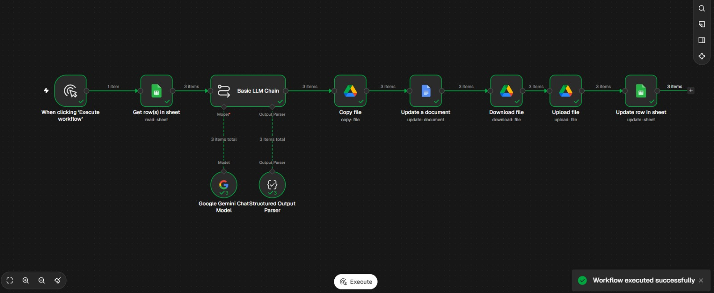
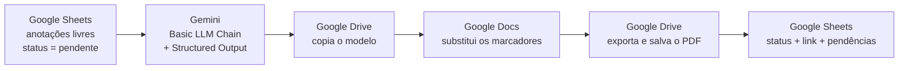
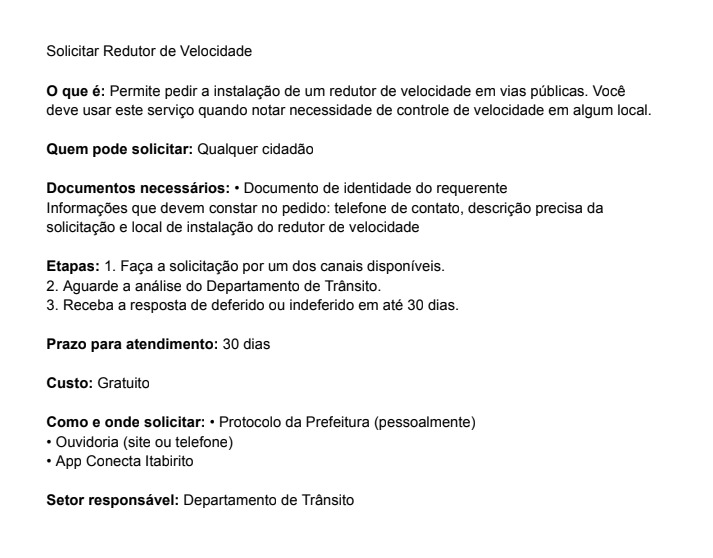

# Gerador de Requerimentos da Carta de Serviços com IA

Automação **n8n + Google Gemini** que transforma anotações informais sobre serviços públicos em requerimentos padronizados, em PDF, para a **Carta de Serviços ao Usuário** (Lei nº 13.460/2017).

Desenvolvida para resolver um problema real de trabalho: mapear os serviços da Secretaria Municipal de Segurança, Prevenção e Mobilidade Urbana de Itabirito (MG) para a Carta de Serviços do Município.



---

## O problema

Cada serviço oferecido ao cidadão precisa virar um requerimento com linguagem simples e com os campos exigidos por lei: o que é, quem pode solicitar, documentos, etapas, prazo, custo, canais e setor responsável.

Escrito à mão, o processo tem três problemas:

- **Inconsistência:** cada documento sai com um formato e um tom diferentes.
- **Campos esquecidos:** é fácil omitir uma informação obrigatória sem perceber.
- **Não escala:** o esforço cresce linearmente com o número de serviços.

## A solução

O levantamento é feito numa planilha, com anotações livres, do jeito que a informação chega. O fluxo faz o resto:



1. **Leitura:** busca na planilha apenas os serviços com `status = pendente`.
2. **Estruturação com IA:** o Gemini converte as anotações em 10 campos padronizados, validados por um *Structured Output Parser*.
3. **Geração do documento:** copia um modelo do Google Docs e substitui os marcadores (`{{DESCRICAO}}`, `{{ETAPAS}}`…).
4. **PDF:** converte o documento e salva numa pasta do Drive.
5. **Retorno:** atualiza a planilha com o link do PDF, as pendências e o status: `gerado` ou `revisar`.

## Decisões de projeto

| Decisão | Motivo |
|---|---|
| **Structured output** (JSON com schema fixo) | Garante que o modelo sempre devolva os mesmos campos, prontos para preencher o modelo sem pós-processamento. |
| **Temperatura 0.2** | Documento oficial precisa de consistência, não de criatividade. |
| **Regra "nunca inventar"** | Se falta uma informação, o modelo escreve `[CONFIRMAR]` e registra o que falta em `pendencias`. |
| **Human-in-the-loop** | Serviços com pendência recebem status `revisar`. A IA faz o trabalho repetitivo e a validação final é humana. |
| **Processamento em lote (1 item, intervalo de 15 s)** | Respeita o limite de 5 requisições/minuto da cota gratuita da API do Gemini. |
| **Planilha como fila de trabalho** | O campo `status` torna o fluxo idempotente: reexecutar não reprocessa o que já foi gerado. |

## Resultados (primeiro uso real)

| Métrica | Manual | Automação |
|---|---|---|
| Tempo para 3 serviços | ~6 min (redação apenas) | **36 s**, dos quais ~30 s são pausa proposital pela cota gratuita |
| Padronização | variável | 100% no mesmo formato e com os campos da Lei 13.460 |
| Aprovados sem correção | — | **3 de 3** |
| Lacunas detectadas | passavam despercebidas | na 1ª rodada, os 3 serviços foram sinalizados por falta do público-alvo |

O principal ganho não é o tempo em pequena escala. É **padronização, conformidade e detecção de lacunas**, com custo marginal próximo de zero para cada serviço novo.

### Exemplo de saída



## Tecnologias

- **[n8n](https://n8n.io)** (Cloud): orquestração do fluxo
- **Google Gemini** (via Google AI Studio): modelo de linguagem
- **LangChain nodes do n8n:** Basic LLM Chain + Structured Output Parser
- **Google Sheets, Google Docs e Google Drive:** entrada, modelo e saída

## Estrutura do repositório

```
├── README.md
├── workflow/
│   └── carta-servicos-gerador.json      # fluxo exportado do n8n
├── prompts/
│   └── system-prompt.md                 # instruções do modelo
├── exemplos/
│   ├── servicos_entrada_exemplo.csv     # formato da planilha de entrada
│   └── modelo_requerimento.md           # estrutura do modelo no Google Docs
└── docs/
    ├── fluxo-n8n.png
    └── exemplo-pdf.png
```

## Como reproduzir

1. **Planilha:** crie uma planilha no Google Sheets com as colunas de [`exemplos/servicos_entrada_exemplo.csv`](exemplos/servicos_entrada_exemplo.csv) e marque os serviços como `pendente`.
2. **Modelo:** crie um Google Docs com os marcadores de [`exemplos/modelo_requerimento.md`](exemplos/modelo_requerimento.md).
3. **Pastas:** crie no Drive as pastas de saída dos documentos e dos PDFs.
4. **Chave de API:** gere uma chave gratuita no [Google AI Studio](https://aistudio.google.com).
5. **Importação:** no n8n, use **Import from File** com [`workflow/carta-servicos-gerador.json`](workflow/carta-servicos-gerador.json).
6. **Credenciais:** reconecte as credenciais (Google Sheets, Drive, Docs e Gemini) e selecione sua planilha, seu modelo e suas pastas em cada nó.
7. **Execução:** clique em **Execute workflow**.

> As credenciais não são exportadas pelo n8n. Cada pessoa usa as próprias.

## Privacidade

O fluxo processa apenas **informações públicas sobre serviços**, nunca dados de cidadãos. Todo documento gerado passa por revisão humana antes da publicação.

## Próximos passos

- [ ] Trigger automático (ao adicionar uma linha na planilha) em vez de execução manual
- [ ] Notificação por e-mail quando houver serviços para revisar
- [ ] Segunda etapa de IA para revisar a linguagem segundo critérios de linguagem simples
- [ ] Versão com modelo local para processar dados não públicos

---

**Autora:** Manuela Gois · Estudante de Análise e Desenvolvimento de Sistemas (FIAP) · [GitHub](https://github.com/manucgois)
